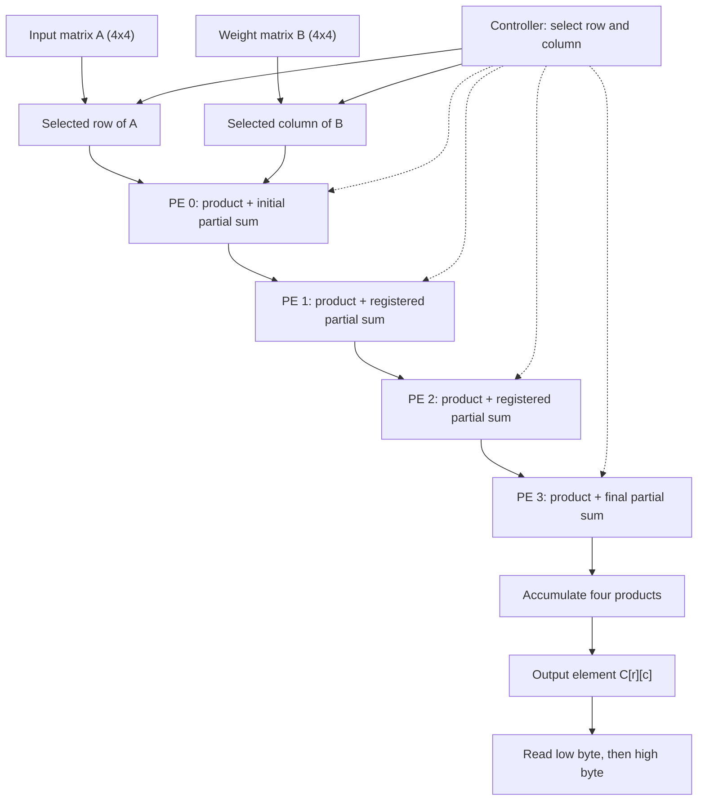

# Resource-Shared 4×4 INT4 Matrix Multiplication Accelerator

[](https://github.com/VarunKB06/cnn-tiny-tapeout)
[](https://github.com/VarunKB06/cnn-tiny-tapeout/actions/workflows/test.yaml)
[](https://github.com/VarunKB06/cnn-tiny-tapeout/actions/workflows/gds.yaml)
[](https://github.com/VarunKB06/cnn-tiny-tapeout/actions/workflows/fpga.yaml)

A Tiny Tapeout / SKY130 RTL project implementing a resource-shared 4×4 signed INT4 matrix-multiplication accelerator. The design computes `C = A × B` using four processing elements (PEs), reused to calculate one output element at a time. Matrix B is loaded and retained while rows of matrix A are streamed sequentially.

> **Architecture scope:** The RTL module is named `systolic_array`, and the four PEs form a registered 1×4 partial-sum/MAC chain. However, the overall accelerator is **not a conventional fully parallel 2D systolic array**: it time-multiplexes that chain across output columns and rows. It is a resource-shared, systolic-style dot-product datapath, not a 16-PE array or a complete CNN convolution pipeline.

## Highlights

- Signed INT4 matrix inputs, with values from −8 through +7.
- Four reusable processing elements.
- Signed 10-bit accumulation and output storage.
- Sequential calculation of all 16 output elements using four reused PEs.
- Weight-stationary input protocol: load matrix B once, then stream rows of matrix A.
- Tiny Tapeout standard I/O wrapper and byte-wise result-reading protocol.
- Cocotb regression tests and automated LibreLane SKY130 physical-design flow.

## Architecture

For each output element `C[r][c]`, the controller selects the four values in row `A[r]` and the four values in column `B[:,c]`. Each PE multiplies one corresponding pair and passes a registered partial sum to the next PE. The fourth PE holds the completed 10-bit result while the host reads its two bytes. After the host advances, the same four PEs are cleared and reused for the next column, then the next row. The feature-forwarding output exists in the PE module but is not used to move A data between PEs in this matrix mode.



## Arithmetic

For signed INT4 matrices A and B, each element of matrix C is a four-term dot product:

\[
C[r][c] = \sum_{k=0}^{3} A[r][k]B[k][c]
\]

Each input value ranges from −8 through +7. The accumulator and output use signed 10-bit representation.

The maximum positive result is:

`(-8) × (-8) × 4 = +256`

This value cannot be represented by a signed 9-bit accumulator, so 10 bits are required to represent the complete result range without overflow.

## Interface and command protocol

The wrapper uses the standard Tiny Tapeout signals.

| Signal | Use |
|---|---|
| `clk` | Clock input |
| `rst_n` | Active-low reset |
| `ena` | Design enable |
| `ui_in[3:0]` | INT4 input value in two's-complement form |
| `ui_in[7:4]` | Unused |
| `uio_in[1:0]` | Command input |
| `uio_in[7:2]` | Unused |
| `uo_out[7:0]` | Current result byte |
| `uio_out[2]` | Busy status |
| `uio_out[3]` | Result-ready status for the current element |
| `uio_oe[3:2]` | Status pins enabled as outputs |

Commands are encoded in `uio_in[1:0]`.

| Command | Encoding | Meaning |
|---|---|---|
| IDLE | `00` | No operation or inter-command gap |
| LOAD | `01` | Load one INT4 value from `ui_in[3:0]` |
| START | `10` | Start processing after the required inputs have been loaded |
| READ | `11` | Advance the result-byte read sequence |

### Input loading order

Issue one LOAD command per INT4 value, with an IDLE cycle between commands.

**Step 1: Load matrix B.**

Load all 16 elements of matrix B in row-major order:

`B[0][0]`, `B[0][1]`, ..., `B[0][3]`, followed by the remaining rows through `B[3][3]`.

**Step 2: Load a row of matrix A.**

For each row `r = 0..3`, load the four elements:

`A[r][0]`, `A[r][1]`, `A[r][2]`, `A[r][3]`.

**Step 3: Start the computation.**

Issue START after loading the required input values for the current transaction.

**Step 4: Read the results.**

Read the four output elements for the current row, following the result-ready status and byte-reading protocol. Repeat the row-loading and computation sequence for the remaining rows of A.

Matrix B is retained across the row computations according to the design's control protocol.

Only `ui_in[3:0]` is used for input data. Examples of signed INT4 encoding:

- −1: `4'b1111`
- −8: `4'b1000`
- +7: `4'b0111`

### Reading results

The core calculates the four elements in the current row of C sequentially. Each result is a signed 10-bit value, sign-extended to 16 bits for byte-wise reading.

For each output element:

1. Wait for `uio_out[3]` to indicate that the element is ready.
2. Issue READ to obtain the low byte.
3. Insert the required IDLE cycle.
4. Issue READ to obtain the high byte.
5. Continue to the next output element according to the wrapper protocol.

| Element | Output |
|---|---|
| First element in the row | `C[r][0]`, low byte then high byte |
| Second element in the row | `C[r][1]`, low byte then high byte |
| Third element in the row | `C[r][2]`, low byte then high byte |
| Fourth element in the row | `C[r][3]`, low byte then high byte |

Across all four rows, the result matrix contains 16 elements, corresponding to 32 output bytes.

The result-ready signal indicates readiness for the current element; it should not be interpreted as a flag that necessarily remains asserted until every byte of the complete matrix has been read.

## Verification and current physical-design results

The Cocotb regression in `test/test.py` defines six tests:

| Test | Coverage |
|---|---|
| `test_int4_matrix_multiply_4x4` | Directed signed-INT4 matrix cases; compares all 16 results against a Python reference model. |
| `test_ena_low_during_completion` | Checks that result-ready is retained if an element completes while `ena` is low. |
| `test_status_signals` | Checks busy/result-valid status, output-enable, reserved bits, and byte ordering. |
| `test_reset_during_compute_and_recovery` | Checks reset during computation and recovery. |
| `test_repeated_transactions_without_reset` | Checks back-to-back matrix transactions without an intervening reset. |
| `test_deterministic_randomized_matrices` | Checks reproducible randomized matrices using seed `0xC0C07B`. |

Run the test suite against the exact revision intended for tapeout:

```sh
cd test
make clean
make
python -m cocotb_tools.check_results results.xml
```

A test result is verified only when the current revision's regression completes with zero failures. Use the [RTL test workflow](https://github.com/VarunKB06/cnn-tiny-tapeout/actions/workflows/test.yaml) to inspect the run corresponding to the commit being evaluated.

### GDS / physical-design status

Use the [GDS workflow](https://github.com/VarunKB06/cnn-tiny-tapeout/actions/workflows/gds.yaml) and open the run for the **same commit as the current matrix-multiplication RTL**. That workflow runs the GDS build, Tiny Tapeout precheck, gate-level test, and viewer deployment.

**No numeric area, timing, DRC, LVS, antenna, or gate-level pass figures are reproduced here from the older RTL revision.** The uploaded project archive does not contain the report artifacts for a new matrix-RTL run, so copying old metrics into this section would incorrectly attribute them to the current design. After opening the latest successful run, add only metrics confirmed by its artifacts, together with the run URL and full commit SHA.

The current `src/config.json` sets `RUN_KLAYOUT_DRC` to `0`; therefore KLayout DRC is disabled in this configuration. Do not report KLayout DRC as passed unless it is run separately. Distinguish Magic DRC, LVS, antenna checks, gate-level simulation, and Tiny Tapeout precheck because they are separate checks.

Physical-design results are EDA estimates and checks, not measurements from fabricated silicon. Keep `src/config.json` and `info.yaml` with the report so the run can be reproduced.

## Repository layout

```text
.
├── .github/workflows/   # Tiny Tapeout test and GDS workflows
├── docs/
│   ├── info.md          # Project documentation
│   └── verification.md  # Test and physical-design notes
├── src/
│   ├── config.json      # Physical-design configuration
│   └── project.v        # PE, controller, core, and Tiny Tapeout wrapper
├── test/
│   ├── tb.v             # Tiny Tapeout simulation harness
│   ├── test.py          # Cocotb functional tests
│   └── README.md        # Test instructions
└── info.yaml            # Tiny Tapeout project metadata and pin descriptions
```

## Limitations and future work

- The datapath implements 4×4 signed INT4 matrix multiplication; it is not a complete CNN convolution pipeline.
- Four PEs are reused over time to calculate one matrix result element at a time, reducing the multiplier count at the cost of sequential processing latency.
- The remaining historical clock-fanout warning should be reviewed for the intended shuttle; workflow success does not imply that every electrical warning is absent.
- Future work includes documenting hardware bring-up, collecting reproducible area/timing comparisons, and evaluating alternative PE reuse schedules.

## Project Team

- [Varun K B](https://github.com/VarunKB06)
- [rahular2005](https://github.com/rahular2005)

## Authors

- [Varun K B](https://github.com/VarunKB06)
- [rahular2005](https://github.com/rahular2005)

## Guide

- Dr. Rakhi S

## Institution

- Atria Institute of Technology

## Acknowledgements

Built with the Tiny Tapeout project template, LibreLane, Verilator, Cocotb, and the SkyWater SKY130 PDK. See the upstream tool and PDK documentation for tool-specific details.
