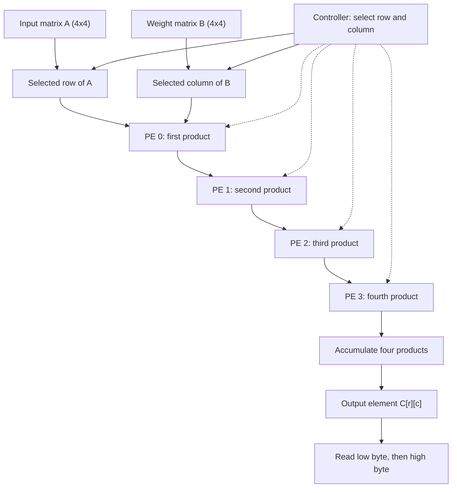

# Resource-Shared 4×4 INT4 Matrix Multiplication Accelerator

[](https://github.com/VarunKB06/cnn-tiny-tapeout)
[](https://github.com/VarunKB06/cnn-tiny-tapeout/actions/workflows/test.yaml)
[](https://github.com/VarunKB06/cnn-tiny-tapeout/actions/workflows/gds.yaml)
[](https://github.com/VarunKB06/cnn-tiny-tapeout/actions/workflows/fpga.yaml)

A Tiny Tapeout / SKY130 RTL project implementing a resource-shared 4×4 signed INT4 matrix-multiplication accelerator. Instead of instantiating sixteen processing elements (PEs), the design reuses four PEs to calculate one element of the output matrix `C = A × B` at a time. Matrix B is stored while rows of matrix A are loaded and processed sequentially.

> **Architecture scope:** This design implements 4×4 matrix multiplication using four reused PEs. It is not a fully parallel 16-PE systolic array or a complete CNN convolution pipeline.

## Highlights

- Signed INT4 matrix inputs, with values from −8 through +7.
- Four reusable processing elements.
- Signed 10-bit accumulation and output storage.
- Sequential calculation of all 16 output elements using four reused PEs.
- Weight-stationary input protocol: load matrix B once, then stream rows of matrix A.
- Tiny Tapeout standard I/O wrapper and byte-wise result-reading protocol.
- Cocotb regression tests and automated LibreLane SKY130 physical-design flow.

## Architecture

Each PE contains a signed 4-bit multiplier, a signed accumulator, and registered feature forwarding. For each row `r` of matrix A and column `c` of matrix B, the controller selects the four elements of the corresponding row and column. The four PEs calculate the dot product for `C[r][c]`. The same PEs are reused for the next column and row.



## Arithmetic

For signed INT4 matrices A and B, each element of matrix C is a four-term dot product:

\[
C[r][c] = \sum_{k=0}^{3} A[r][k]B[k][c]
\]

Each input value ranges from −8 through +7. The accumulator and output use signed 10-bit representation.

The maximum positive result is:

`(-8) × (-8) × 4 = +256`

This value cannot be represented by a signed 9-bit accumulator, so 10 bits are required to represent the complete result range without overflow.

## Interface and command protocol

The wrapper uses the standard Tiny Tapeout signals.

| Signal | Use |
|---|---|
| `clk` | Clock input |
| `rst_n` | Active-low reset |
| `ena` | Design enable |
| `ui_in[3:0]` | INT4 input value in two's-complement form |
| `ui_in[7:4]` | Unused |
| `uio_in[1:0]` | Command input |
| `uio_in[7:2]` | Unused |
| `uo_out[7:0]` | Current result byte |
| `uio_out[2]` | Busy status |
| `uio_out[3]` | Result-ready status for the current element |
| `uio_oe[3:2]` | Status pins enabled as outputs |

Commands are encoded in `uio_in[1:0]`.

| Command | Encoding | Meaning |
|---|---|---|
| IDLE | `00` | No operation or inter-command gap |
| LOAD | `01` | Load one INT4 value from `ui_in[3:0]` |
| START | `10` | Start processing after the required inputs have been loaded |
| READ | `11` | Advance the result-byte read sequence |

### Input loading order

Issue one LOAD command per INT4 value, with an IDLE cycle between commands.

**Step 1: Load matrix B.**

Load all 16 elements of matrix B in row-major order:

`B[0][0]`, `B[0][1]`, ..., `B[0][3]`, followed by the remaining rows through `B[3][3]`.

**Step 2: Load a row of matrix A.**

For each row `r = 0..3`, load the four elements:

`A[r][0]`, `A[r][1]`, `A[r][2]`, `A[r][3]`.

**Step 3: Start the computation.**

Issue START after loading the required input values for the current transaction.

**Step 4: Read the results.**

Read the four output elements for the current row, following the result-ready status and byte-reading protocol. Repeat the row-loading and computation sequence for the remaining rows of A.

Matrix B is retained across the row computations according to the design's control protocol.

Only `ui_in[3:0]` is used for input data. Examples of signed INT4 encoding:

- −1: `4'b1111`
- −8: `4'b1000`
- +7: `4'b0111`

### Reading results

The core calculates the four elements in the current row of C sequentially. Each result is a signed 10-bit value, sign-extended to 16 bits for byte-wise reading.

For each output element:

1. Wait for `uio_out[3]` to indicate that the element is ready.
2. Issue READ to obtain the low byte.
3. Insert the required IDLE cycle.
4. Issue READ to obtain the high byte.
5. Continue to the next output element according to the wrapper protocol.

| Element | Output |
|---|---|
| First element in the row | `C[r][0]`, low byte then high byte |
| Second element in the row | `C[r][1]`, low byte then high byte |
| Third element in the row | `C[r][2]`, low byte then high byte |
| Fourth element in the row | `C[r][3]`, low byte then high byte |

Across all four rows, the result matrix contains 16 elements, corresponding to 32 output bytes.

The result-ready signal indicates readiness for the current element; it should not be interpreted as a flag that necessarily remains asserted until every byte of the complete matrix has been read.

## Verification

The Cocotb regression is intended to cover:

- 4×4 signed INT4 matrix multiplication.
- Completion behavior while `ena` is low.
- Status signals and result-byte ordering.
- Reset recovery.
- Repeated transactions without reset.
- Deterministic randomized matrix pairs using seed `0xC0C07B`.

The functional tests should compare all 16 output elements against a Python reference model.

Run the regression against the current RTL before relying on any earlier test results. A successful test on an earlier non-matrix implementation does not verify the current matrix-multiplication implementation.

- [Test workflow](https://github.com/VarunKB06/cnn-tiny-tapeout/actions/workflows/test.yaml)
- [Previously tested commit `98a19b3`](https://github.com/VarunKB06/cnn-tiny-tapeout/commit/98a19b3)

The GDS workflow includes a gate-level test. The physical-design results below belong to an earlier project revision and are included for historical reference only. They must not be interpreted as measurements or verification results for the current matrix-multiplication RTL.

## Historical physical-design snapshot (previous RTL revision)

The following figures are from [GDS workflow run 38365315668](https://github.com/VarunKB06/cnn-tiny-tapeout/actions/runs/38365315668), commit [`162f691`](https://github.com/VarunKB06/cnn-tiny-tapeout/commit/162f691557bef0d33352218c2a7ba2ffdda59a8d). These are EDA flow results, not measurements from fabricated silicon.

| Metric | Recorded result |
|---|---:|
| Standard-cell area | 13,088.8 µm² |
| Core area | 16,493.3 µm² |
| Core utilization | 79.36% |
| Worst setup slack | +6.292 ns |
| Worst hold slack | +0.115 ns |
| Setup / hold violation counts | 0 / 0 |
| Max-slew violations under configured 1.5 ns constraint | 0 |
| Max-capacitance violations | 0 |
| Max-fanout violations | 1 |
| Reported Magic DRC errors | 0 |
| Reported LVS device/net differences | 0 / 0 |
| Antenna violations | 0 |

**Known item under review:** The historical run reported one max-fanout violation on the root clock buffer (`clkbuf_0_clk/X`), which drove 16 loads against the configured fanout limit of 10.

The configured 1.5 ns maximum-transition constraint changes the checking threshold; it should not be described as physically reducing the signal transition time.

The configuration sets `RUN_KLAYOUT_DRC: 0`. Therefore, KLayout DRC was not run in that configuration and should not be described as passed.

For reproducibility, retain the run URL, full commit SHA, `src/config.json`, `info.yaml`, and the corresponding GDS logs with future reports.

## Repository layout

```text
.
├── .github/workflows/   # Tiny Tapeout test and GDS workflows
├── docs/
│   ├── info.md          # Project documentation
│   └── verification.md  # Test and physical-design notes
├── src/
│   ├── config.json      # Physical-design configuration
│   └── project.v        # PE, controller, core, and Tiny Tapeout wrapper
├── test/
│   ├── tb.v             # Tiny Tapeout simulation harness
│   ├── test.py          # Cocotb functional tests
│   └── README.md        # Test instructions
└── info.yaml            # Tiny Tapeout project metadata and pin descriptions
```

## Limitations and future work

- The datapath implements 4×4 signed INT4 matrix multiplication; it is not a complete CNN convolution pipeline.
- Four PEs are reused over time to calculate one matrix result element at a time, reducing the multiplier count at the cost of sequential processing latency.
- The remaining historical clock-fanout warning should be reviewed for the intended shuttle; workflow success does not imply that every electrical warning is absent.
- Future work includes documenting hardware bring-up, collecting reproducible area/timing comparisons, and evaluating alternative PE reuse schedules.

## Project Team

- [Varun K B](https://github.com/VarunKB06)
- [rahular2005](https://github.com/rahular2005)

## Authors

- [Varun K B](https://github.com/VarunKB06)
- [rahular2005](https://github.com/rahular2005)

## Guide

- Dr. Rakhi S

## Institution

- Atria Institute of Technology

## Acknowledgements

Built with the Tiny Tapeout project template, LibreLane, Verilator, Cocotb, and the SkyWater SKY130 PDK. See the upstream tool and PDK documentation for tool-specific details.
