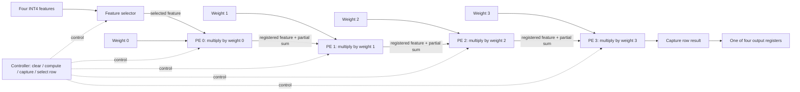

# Resource-Shared 4×4 INT4 MAC Accelerator

[](https://github.com/VarunKB06/cnn-tiny-tapeout)
[](https://github.com/VarunKB06/cnn-tiny-tapeout/actions/workflows/test.yaml)
[](https://github.com/VarunKB06/cnn-tiny-tapeout/actions/workflows/gds.yaml)
[](https://github.com/VarunKB06/cnn-tiny-tapeout/actions/workflows/fpga.yaml)

A Tiny Tapeout / SKY130 RTL project exploring resource sharing for a four-feature, four-weight INT4 multiply-accumulate workload. Rather than instantiating sixteen processing elements (PEs), the design reuses a chain of four PEs to process four feature rows sequentially.

> **Architecture scope:** This is a resource-shared 4×4 workload, not a fully parallel 16-PE systolic array or a general matrix-multiplication engine. For each transaction, the current datapath computes `y[r] = feature[r] × sum(weights[0:4])` for `r = 0..3`.

## Highlights

- Signed INT4 input values (−8 through +7)
- Four reusable processing elements
- Signed 10-bit accumulation and output storage
- Sequential processing of four feature values
- Tiny Tapeout standard I/O wrapper and byte-wise result-read protocol
- Cocotb regression tests and automated LibreLane SKY130 physical-design flow

## Architecture

Each PE contains a signed 4-bit multiplier, a signed accumulator, and registered feature forwarding. The controller selects one feature value, clears the PE chain, runs four compute-enabled cycles, and captures the row result. The same four PEs are then reused for the next feature.



## Arithmetic

For signed INT4 feature `x[r]` and signed INT4 weights `w[0]` through `w[3]`:

\[
y[r] = x[r] \times (w[0] + w[1] + w[2] + w[3])
\]

The sum of four signed INT4 weights ranges from −32 to +28. The largest positive output is `(-8) × (-32) = +256`. A signed 10-bit result is used because a signed 9-bit value can represent only up to +255.

## Interface and command protocol

The wrapper uses the standard Tiny Tapeout signals.

| Signal | Use |
|---|---|
| `clk` | Clock input |
| `rst_n` | Active-low reset |
| `ena` | Design enable |
| `ui_in[3:0]` | INT4 input value in two's-complement form |
| `ui_in[7:4]` | Unused |
| `uio_in[1:0]` | Command input |
| `uio_in[7:2]` | Unused |
| `uo_out[7:0]` | Current result byte |
| `uio_out[2]` | Busy status |
| `uio_out[3]` | Result-valid status; stays high until all eight result bytes are read |
| `uio_oe[3:2]` | Status pins enabled as outputs |

Commands are encoded in `uio_in[1:0]`:

| Command | Encoding | Meaning |
|---|---|---|
| IDLE | `00` | No operation / inter-command gap |
| LOAD | `01` | Load one INT4 nibble from `ui_in[3:0]` |
| START | `10` | Start processing after all eight values are loaded |
| READ | `11` | Advance to the next result byte |

### Input loading order

Issue one LOAD command for each value, with an IDLE cycle between commands:

1. `feature_0`
2. `feature_1`
3. `feature_2`
4. `feature_3`
5. `weight_0`
6. `weight_1`
7. `weight_2`
8. `weight_3`

Only `ui_in[3:0]` is used. For example, −1 is encoded as `4'b1111`, −8 as `4'b1000`, and +7 as `4'b0111`.

### Reading results

After computation completes, wait for `uio_out[3]` (result-valid). It remains high until all eight result bytes are read, including if `ena` is low when computation finishes. Read eight bytes, with one READ command per byte and an IDLE cycle between commands.

| Byte index | Value |
|---:|---|
| 0, 1 | `output_0`, low byte then high byte |
| 2, 3 | `output_1`, low byte then high byte |
| 4, 5 | `output_2`, low byte then high byte |
| 6, 7 | `output_3`, low byte then high byte |

Each signed 10-bit output is sign-extended to 16 bits before byte-wise reading.

## Verification

The Cocotb regression contains six tests: seven directed arithmetic vectors, the `ena` completion-handshake test, status-signal checks, reset recovery, repeated transactions without reset, and 20 deterministic randomized vectors (seed `0xC0C07B`). The latest supplied GitHub Actions result reported all six tests passing.

- [Test workflow history](https://github.com/VarunKB06/cnn-tiny-tapeout/actions/workflows/test.yaml)
- [Tested commit `98a19b3`](https://github.com/VarunKB06/cnn-tiny-tapeout/commit/98a19b3)

The GDS workflow includes the gate-level test. The successful archived run below was built at commit `162f691557bef0d33352218c2a7ba2ffdda59a8d`; the user-confirmed `gl_test` passed for that run.

## Latest recorded physical-design snapshot

The following figures are from [GDS workflow run 38365315668](https://github.com/VarunKB06/cnn-tiny-tapeout/actions/runs/38365315668), commit [`162f691`](https://github.com/VarunKB06/cnn-tiny-tapeout/commit/162f691557bef0d33352218c2a7ba2ffdda59a8d). These are EDA flow results, not measurements from fabricated silicon.

| Metric | Recorded result |
|---|---:|
| Standard-cell area | 13,088.8 µm² |
| Core area | 16,493.3 µm² |
| Core utilization | 79.36% |
| Worst setup slack | +6.292 ns |
| Worst hold slack | +0.115 ns |
| Setup / hold violation counts | 0 / 0 |
| Max-slew violations under configured 1.5 ns constraint | 0 |
| Max-capacitance violations | 0 |
| Max-fanout violations | 1 |
| Reported Magic DRC errors | 0 |
| Reported LVS device/net differences | 0 / 0 |
| Antenna violations | 0 |

**Known item under review:** this run reports one max-fanout violation on the root clock buffer (`clkbuf_0_clk/X`), which drives 16 loads against the configured fanout limit of 10. The 1.5 ns maximum-transition constraint changes the checking threshold; it should not be described as physically reducing signal transition time. The configuration sets `RUN_KLAYOUT_DRC: 0`, so KLayout DRC was not run and should not be described as passed.

For reproducibility, retain the run URL, full commit SHA, `src/config.json`, `info.yaml`, and corresponding GDS logs with future reports.

## Repository layout

```text
.
├── .github/workflows/   # Tiny Tapeout test and GDS workflows
├── docs/
│   ├── info.md          # Project documentation
│   └── verification.md  # Test and physical-design notes
├── src/
│   ├── config.json      # Physical-design configuration
│   └── project.v        # PE, controller, core, and Tiny Tapeout wrapper
├── test/
│   ├── tb.v             # Tiny Tapeout simulation harness
│   └── test.py          # Cocotb functional tests
└── info.yaml            # Tiny Tapeout project metadata and pin descriptions
```

## Limitations and future work

- The datapath implements the specific four-output formula shown above; it is not a general 4×4 matrix-multiplication engine or a complete CNN convolution pipeline.
- Four PEs are reused over time, reducing multiplier count at the cost of sequential processing latency.
- The remaining clock-fanout warning should be reviewed for the intended shuttle; workflow success is not a claim that every electrical warning is absent.
- Future work includes documenting hardware bring-up, collecting reproducible area/timing comparisons, and evaluating alternative PE reuse schedules.

## Project Team

- [Varun K B](https://github.com/VarunKB06)
- [rahular2005](https://github.com/rahular2005)

## Authors

- [Varun K B](https://github.com/VarunKB06)
- [rahular2005](https://github.com/rahular2005)

## Guide
- Dr.Rakhi S

## Institution
- Atria Institute of Technology

## Acknowledgements

Built with the Tiny Tapeout project template, LibreLane, Verilator, Cocotb, and the SkyWater SKY130 PDK. See the upstream tool and PDK documentation for tool-specific details.
